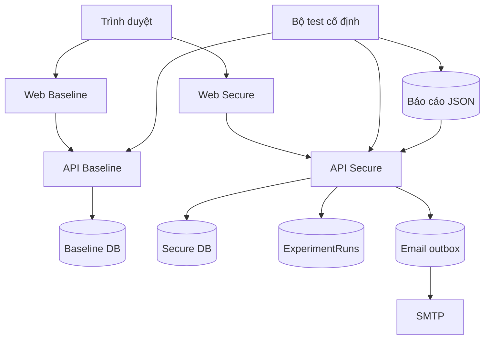

# Kiến trúc BookGuard

## Quyết định kiến trúc

BookGuard dùng **modular monolith** để đảm bảo mã nguồn đủ rõ cho luận án nhưng vẫn dễ triển khai, kiểm thử và bảo trì. Hai API được chạy từ cùng một source với biến môi trường `SECURITY_MODE`; các nhánh khác biệt đều được đánh dấu `SECURITY LAB` trong mã nguồn.

## Biên tin cậy

1. Người dùng và trình duyệt là vùng không tin cậy.
2. Frontend không được quyết định quyền truy cập; API kiểm tra lại mọi quyền.
3. API và SQL Server giao tiếp bằng tài khoản database riêng.
4. File tải lên được xem là dữ liệu không tin cậy.
5. Log bảo mật không chứa mật khẩu, token đầy đủ hoặc dữ liệu thanh toán.

## Sáu lớp bảo mật

| Lớp | Phạm vi | Kiểm soát chính ở Secure |
|---|---|---|
| 1. HTTP và giao tiếp | Request, response, CORS | Helmet, allowlist origin, giới hạn body, TLS khi triển khai |
| 2. Input/output | Form, tìm kiếm, review, upload | Zod, parameterized query, plain-text rendering, kiểm tra magic bytes |
| 3. Xác thực và phiên | Mật khẩu, JWT, cookie | Argon2id, access token ngắn hạn, refresh token xoay vòng, HttpOnly cookie, token version |
| 4. Phân quyền | Admin API, dữ liệu sở hữu | RBAC tại API, ownership check |
| 5. Database và dữ liệu | Tài khoản, đơn, database | least privilege, DTO lọc dữ liệu, transaction |
| 6. Logging và monitoring | Sự kiện bị từ chối | request ID, security event có cấu trúc, trang theo dõi cho admin |

## Luồng dữ liệu v1.5

- `db-init` tạo `SchemaMigrations`, kiểm tra checksum và chạy tuần tự từng migration trong transaction. Schema lõi v1.4 được đóng băng ở migration 1; bảng vận hành/thực nghiệm v1.5 nằm ở migration 2.
- Mỗi thay đổi tồn kho ghi `InventoryMovements` trong cùng transaction với `Books.Stock`. Bản ghi có delta, số dư sau thay đổi, đơn tham chiếu, ghi chú và người thao tác; API sửa sách không được đổi kho trực tiếp.
- Tạo đơn, hủy đơn hoặc admin chuyển trạng thái đồng thời ghi `OrderNotifications`. Sau commit, worker nhận bản ghi pending, gửi SMTP và cập nhật sent/failed; lỗi gửi không làm mất giao dịch đơn.
- Báo cáo security, functional, Playwright và k6 được whitelist tên, giới hạn kích thước, validate bằng Zod rồi lưu `ExperimentRuns`. SHA-256 của nội dung ngăn nhập cùng kết quả hai lần.
- Dashboard admin dùng truy vấn SQL tổng hợp doanh thu, trạng thái, sách bán nổi bật và kho thấp. Dashboard thực nghiệm chỉ đọc lịch sử đã nhập; CPU/RAM không có trong báo cáo sẽ để null.

## Luồng dữ liệu nền tảng v1.4

- Quên mật khẩu tạo token ngẫu nhiên; chỉ hash token được lưu trong SQL Server. Email chứa token gốc được gửi qua SMTP và token bị vô hiệu hóa sau lần dùng đầu tiên.
- Xác minh email dùng token riêng, lưu hash và thời hạn trong `EmailVerificationTokens`; tài khoản Secure chưa xác minh không được tạo phiên đăng nhập.
- Đăng nhập thành công tạo `UserSessions`. JWT truy cập mang `sessionId`; Secure đối chiếu chữ ký, issuer/audience, `TokenVersion`, trạng thái tài khoản và trạng thái phiên trên mỗi request.
- Access token mặc định hết hạn sau 15 phút. Refresh token ngẫu nhiên chỉ tồn tại trong cookie HttpOnly/SameSite Strict; SQL chỉ lưu SHA-256. Mỗi lần gia hạn sẽ xoay token trong transaction, và việc dùng lại token đã thu hồi sẽ làm vô hiệu hóa cả phiên.
- Checkout Secure bắt buộc idempotency key. Cùng khóa của cùng người dùng chỉ trả lại đơn đã tạo, còn trừ kho, tạo order/item, lịch sử trạng thái và xóa giỏ nằm trong một transaction serializable.
- Mọi chuyển trạng thái đơn được kiểm tra bằng state machine và ghi vào `OrderStatusHistory`; hủy đơn hoàn kho đúng một lần trong cùng transaction.
- Yêu thích sách được lưu bằng khóa ghép `(UserId, BookId)` trong `WishlistItems`, nên thao tác thêm lặp lại vẫn an toàn và không tạo bản ghi trùng.
- Ảnh bìa được kiểm tra magic bytes, giới hạn 3 MB, đổi tên UUID và lưu metadata vào `Uploads` trước khi gắn với sách.
- Runner kiểm thử ghi JSON/Markdown vào `reports/generated`; API admin validate trước khi hiển thị, xuất CSV hoặc nhập lịch sử SQL.

## Tính công bằng của thí nghiệm

- Cùng chức năng và giao diện.
- Hai database được seed từ cùng một tập dữ liệu.
- Seed chính thức có 36 sách và 60 đơn mẫu, đúng khoảng 30–50 sản phẩm và 50–100 đơn trong đề cương.
- Cùng máy, cùng cấu hình container và cùng bộ test.
- Reset database trước lượt chạy chính thức.
- Lưu request, status, bằng chứng và timestamp thay vì nhập kết quả thủ công.
- Giữ bản báo cáo timestamp, khóa nội dung và lịch sử migration để lượt chạy có thể truy vết.
